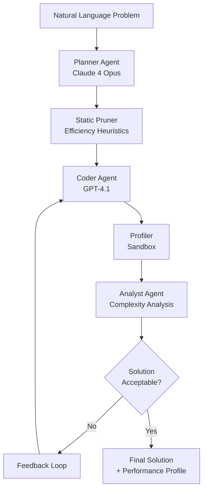

# SwiftSolve: Multi-Agent Code Generation with Efficiency Optimization

[](https://www.python.org/downloads/)
[](https://opensource.org/licenses/MIT)

SwiftSolve is a multi-agent framework that synthesizes functionally correct and computationally efficient C++ code from natural language problem statements. Unlike traditional code generation systems that focus solely on correctness, SwiftSolve co-optimizes for both functional correctness and Big-O efficiency through an iterative feedback loop between planning, coding, profiling, and analysis agents.

## Quick Start

### Prerequisites

- **Python 3.12+** (required for modern type hints and performance)
- **API Keys**: OpenAI GPT-4 and Anthropic Claude API access

### 1. Clone and Setup

```bash
# Clone the repository

#Then,

cd swiftsolve

# Create and activate virtual environment
python3 -m venv venv
source venv/bin/activate  # On Windows: venv\Scripts\activate

# Install dependencies
pip install -r requirements.txt
```

### 2. Environment Configuration

```bash
# Set required environment variables
export OPENAI_API_KEY="your_openai_api_key_here"
export ANTHROPIC_API_KEY="your_anthropic_api_key_here"

# Set Python path for imports
export PYTHONPATH="${PWD}/src"
```

### 3. Verify Installation

```bash
# Test basic functionality with a simple problem
python src/swiftsolve/main.py --task_json src/swiftsolve/test.json
```

## Architecture Overview

SwiftSolve employs a sophisticated multi-agent pipeline that iteratively refines code solutions:



### Core Components

1. **Planner Agent** (Claude 4 Opus): Converts natural language into structured algorithmic plans
2. **Static Pruner**: Filters out obviously inefficient approaches using regex and AST analysis
3. **Coder Agent** (GPT-4.1): Generates C++ code from approved plans
4. **Profiler**: Compiles and benchmarks code with real performance measurements
5. **Analyst Agent**: Evaluates efficiency using heuristics and LLM fallback for complex cases

## Usage Modes

### 1. API Server Mode (Recommended for Research)

Start the FastAPI server for programmatic access:

```bash
# Start the server
PYTHONPATH=src uvicorn swiftsolve.main:app --host 127.0.0.1 --port 8000 --reload

# Server will be available at http://localhost:8000
# API documentation at http://localhost:8000/docs
```

#### Solve Individual Problems

```bash
curl -X POST "http://localhost:8000/solve" \
  -H "Content-Type: application/json" \
  -d '{
    "task_id": "example_1",
    "prompt": "Find the maximum element in an array",
    "constraints": {"runtime_limit": 2000, "memory_limit": 512},
    "unit_tests": [
      {"input": "5\n3 1 4 1 5", "output": "5"},
      {"input": "3\n10 20 30", "output": "30"}
    ]
  }'
```

#### Research Evaluation (Full Benchmark)

```bash
# Full evaluation: 225 iterations (25 tasks × 3 seeds × 3 replans)
curl -X POST "http://localhost:8000/research/evaluate" \
  -H "Content-Type: application/json" \
  -d '{
    "seeds": [42, 123, 456],
    "max_workers": 4,
    "output_dir": "research_results"
  }'
```

#### Mini Evaluation (Quick Testing)

```bash
# Mini evaluation: 18 iterations (2 tasks × 3 seeds × 3 replans)
curl -X POST "http://localhost:8000/mini-research/evaluate" \
  -H "Content-Type: application/json" \
  -d '{
    "seeds": [42, 123, 456],
    "max_workers": 2,
    "output_dir": "mini_results"
  }'
```

### 2. CLI Mode

For direct command-line usage:

```bash
# Solve a single problem from JSON file
python src/swiftsolve/main.py --task_json datasets/bigobench/task_bigobench_1718.json

# Run batch evaluation
python -m src.swiftsolve.evaluation.batch_runner --benchmark --seeds 42 123 456
```

### 3. Testing and Development

```bash
# Test mini-run functionality
python test_mini_run.py

# Run built-in test suite
python dry_run_batch.py --tasks 5

# Run unit tests
python -m pytest src/swiftsolve/tests/
```

## Evaluation and Benchmarking

### Available Datasets

- **BigO(Bench)**: 16 algorithmic tasks with known complexity requirements
- **Codeforces**: 10 competitive programming problems with strict constraints

### Evaluation Metrics

- **pass@k**: Functional correctness across k attempts
- **eff@k_runtime**: Efficiency-optimized success rate for runtime constraints
- **eff@k_memory**: Efficiency-optimized success rate for memory constraints
- **TLE/MLE rates**: Time/Memory limit exceeded frequencies

### Running Evaluations

| Mode | Tasks | Iterations | Duration | Use Case |
|------|-------|------------|----------|----------|
| **Mini-Run** | 2 tasks | 18 iterations | ~5 minutes | Setup testing, development |
| **Full Run** | 25 tasks | 225 iterations | ~60 minutes | Research benchmarking |

```bash
# Quick setup verification
python test_mini_run.py

# Full research evaluation
curl -X POST "http://localhost:8000/research/evaluate" \
  -H "Content-Type: application/json" \
  -d '{"max_workers": 4}'
```

## 🔧 Advanced Configuration

### Environment Variables

| Variable | Purpose | Required |
|----------|---------|----------|
| `OPENAI_API_KEY` | GPT-4.1 access | Yes |
| `ANTHROPIC_API_KEY` | Claude 4 Opus access | Yes |
| `LOG_LEVEL` | Logging verbosity (DEBUG/INFO/WARNING/ERROR) | No |
| `PYTHONPATH` | Python import path | Yes |

### Code Execution Environment

SwiftSolve compiles and executes C++ code directly on your system with resource limits:

```bash
# Verify C++ compiler is available
g++ --version
# or on macOS with Xcode
clang++ --version
```

### Performance Tuning

```bash
# Adjust worker count based on your system
export MAX_WORKERS=4  # Default: 4

# Enable debug logging for troubleshooting
export LOG_LEVEL=DEBUG
```

## 📁 Project Structure

```
swiftsolve/
├── src/swiftsolve/           # Core framework
│   ├── agents/              # Multi-agent components
│   │   ├── planner.py       # Claude 4 Opus planning
│   │   ├── coder.py         # GPT-4.1 code generation
│   │   ├── profiler.py      # Performance profiling
│   │   └── analyst.py       # Efficiency analysis
│   ├── api/                 # FastAPI endpoints
│   ├── controller/          # Pipeline orchestration
│   ├── evaluation/          # Benchmarking infrastructure
│   ├── sandbox/             # Code execution environment
│   └── schemas/             # Data models and validation
├── datasets/                # Evaluation datasets
│   ├── bigobench/          # BigO(Bench) tasks
│   └── codeforces/         # Codeforces problems
├── baseline_test_api/       # Baseline evaluation results
├── test_*.py               # Test scripts
└── requirements.txt        # Dependencies
```

## Testing Your Setup

### 1. Basic Functionality Test

```bash
# Test single problem solving
python src/swiftsolve/main.py --task_json src/swiftsolve/test.json
```

### 2. API Server Test

```bash
# Start server
PYTHONPATH=src uvicorn swiftsolve.main:app --host 127.0.0.1 --port 8000 &

# Test health endpoint
curl http://localhost:8000/healthz

# Test solve endpoint
curl -X POST "http://localhost:8000/solve" \
  -H "Content-Type: application/json" \
  -d '{"task_id": "test", "prompt": "Add two numbers", "constraints": {"runtime_limit": 1000}, "unit_tests": [{"input": "2 3", "output": "5"}]}'
```

### 3. Mini Evaluation Test

```bash
# Run mini evaluation (18 iterations, ~5 minutes)
python test_mini_run.py
```

## Troubleshooting

### Common Issues

**1. Import Errors**
```bash
# Ensure PYTHONPATH is set correctly
export PYTHONPATH="${PWD}/src"
```

**2. C++ Compiler Issues**
```bash
# On macOS, install Xcode command line tools
xcode-select --install

# On Ubuntu/Debian
sudo apt-get install build-essential

# On CentOS/RHEL
sudo yum groupinstall "Development Tools"
```

**3. API Key Issues**
```bash
# Verify API keys are set
echo $OPENAI_API_KEY
echo $ANTHROPIC_API_KEY
```

**4. Port Already in Use**
```bash
# Use different port
PYTHONPATH=src uvicorn swiftsolve.main:app --host 127.0.0.1 --port 8001
```

**5. Memory Issues During Evaluation**
```bash
# Reduce worker count
curl -X POST "http://localhost:8000/research/evaluate" \
  -H "Content-Type: application/json" \
  -d '{"max_workers": 2}'
```

### Debug Mode

Enable detailed logging for troubleshooting:

```bash
export LOG_LEVEL=DEBUG
PYTHONPATH=src uvicorn swiftsolve.main:app --host 127.0.0.1 --port 8000
```

## Performance Expectations

### Typical Performance Metrics

- **Mini-Run (18 iterations)**: ~5 minutes
- **Full Evaluation (225 iterations)**: ~60 minutes
- **Single Problem**: ~15-30 seconds
- **Success Rate**: 60-80% (varies by dataset and constraints)

### Resource Requirements

- **CPU**: 4+ cores recommended for parallel evaluation
- **RAM**: 8GB+ recommended
- **Storage**: 2GB+ for datasets and results
- **Network**: Stable internet for API calls

## Research Usage

### Reproducing Results

1. **Setup Environment**: Follow Quick Start guide
2. **Run Mini Evaluation**: Verify setup with `python test_mini_run.py`
3. **Full Evaluation**: Run complete benchmark with research endpoint
4. **Analyze Results**: Check generated JSON files in output directory

### Custom Evaluations

```bash
# Custom task evaluation
python -m src.swiftsolve.evaluation.batch_runner \
  --custom-tasks datasets/my_tasks/ \
  --seeds 42 123 456 789 \
  --output-dir custom_results
```

### Baseline Comparisons

```bash
# Run baseline evaluation
curl -X POST "http://localhost:8000/baseline/evaluate" \
  -H "Content-Type: application/json" \
  -d '{"model": "gpt-4", "max_workers": 4}'
```

## Citation

If you use SwiftSolve in your research, please cite:

```bibtex
@article{swiftsolve2025,
  title={SwiftSolve: Multi-Agent Code Generation with Efficiency Optimization},
  author={Your Name and Collaborators},
  journal={NeurIPS},
  year={2025}
}
```

## Contributing

We welcome contributions! Please see our contributing guidelines and submit pull requests for any improvements.

## License

This project is licensed under the MIT License - see the LICENSE file for details.

## Support

For questions, issues, or support:

1. Check the troubleshooting section above
2. Review existing issues on GitHub
3. Create a new issue with detailed information about your setup and problem

---

**Note**: This framework requires API access to OpenAI GPT-4 and Anthropic Claude. Ensure you have valid API keys and sufficient credits before running evaluations.